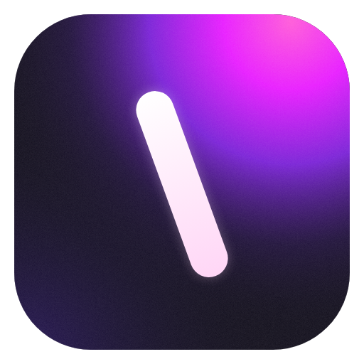
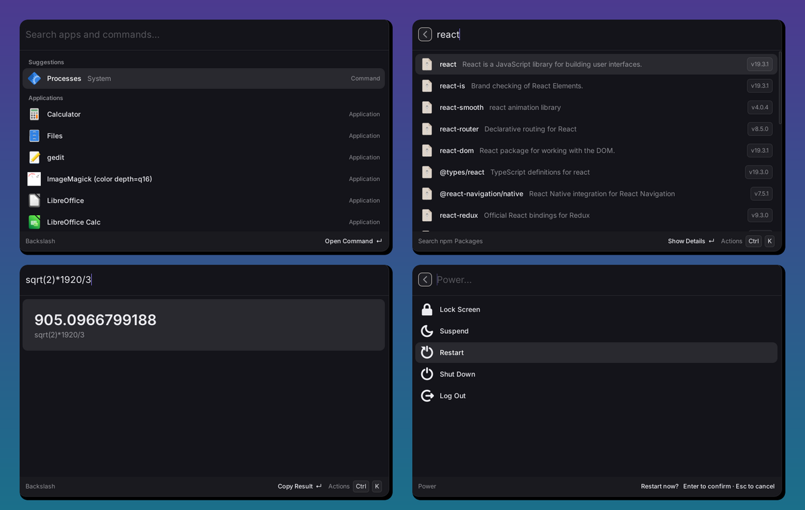

<p align="center"></p>

<h1 align="center">Backslash</h1>

<p align="center"><b>A fast, keyboard-first launcher for Linux, with extensions you can write in five minutes.</b></p>

<p align="center">
  <a href="docs/EXTENSIONS.md">Write an extension</a> ·
  <a href="docs/ARCHITECTURE.md">Architecture</a> ·
  <a href="docs/ROADMAP.md">Roadmap</a> ·
  <a href="https://discord.gg/sTzwBzDkK9">Discord</a>
</p>



> [!IMPORTANT]
> Backslash 0.3 is a ground-up rewrite (Rust + GTK4, Deno extensions). It is
> young: expect rough edges, and see the [roadmap](docs/ROADMAP.md).

## Why Backslash

- **Native and instant.** One small Rust binary, GTK4, GPU-rendered. It stays
  in the background and opens with no delay, on Wayland and X11.
- **Made for Linux.** Applications come straight from your system (Flatpak and
  Snap included), icons from your icon theme, light/dark from your desktop.
- **Extensions that cannot hurt you.** Each extension declares what it needs
  (`net = ["api.github.com"]`, `run = ["git"]`), you approve it once, and the
  runtime enforces it. Tokens go to your system keyring.
  Each command runs in its own process: a buggy extension can't freeze or
  crash the launcher.
- **Extensions that are easy to write.** TypeScript, no build step, no
  `node_modules`. Describe a list, the launcher does the rest: fuzzy search,
  keyboard navigation, action panel, cancellation of slow requests.
- **Useful out of the box.** Calculator and unit/currency conversions as you
  type, clipboard history, file search with previews, window switcher,
  quicklinks and snippets.
- **Scriptable.** Every command also runs from a terminal:
  `backslash run npm/search react --json | jq`.
- **Yours.** Open source (MIT), no account, no telemetry, no paywall. Config
  and theme are plain files you can keep in your dotfiles.

## A complete extension

`backslash.toml`:

```toml
[extension]
id = "npm"
title = "npm"

[permissions]
net = ["registry.npmjs.org"]

[[commands]]
name = "search"
title = "Search npm Packages"
```

`commands/search.ts`:

```ts
import { copy, list, open } from "@backslash/api";

export default list({
  placeholder: "Search npm packages…",
  async search(query, { signal }) {
    const res = await fetch(`https://registry.npmjs.org/-/v1/search?text=${query}`, { signal });
    const { objects } = await res.json();
    return objects.map(({ package: pkg }) => ({
      title: pkg.name,
      subtitle: pkg.description,
      tags: [`v${pkg.version}`],
      actions: [open(pkg.links.npm), copy(`npm install ${pkg.name}`, "Copy Install Command")],
    }));
  },
});
```

That's it. `backslash new <name>` scaffolds one, `backslash dev` loads it with
logs in your terminal and reloads it when you save. `backslash publish` prepares
its registry entry. Read the [extension guide](docs/EXTENSIONS.md).

## Extensions

Open **Browse Extensions** (or `backslash search`, `backslash install github`).
The [registry](https://github.com/backslash-app/plugins) lists extensions that
live in their authors' repositories, each pinned to a reviewed commit with a
checksum: you see exactly what an extension may do before installing, and
Backslash refuses any file that differs from what was reviewed. First-party
extensions: GitHub, Packages (apt/dnf/pacman/zypper/Flathub), Services
(systemd), Containers (Docker/Podman), Emoji & Symbols.

## Install

Backslash needs GTK 4.14 or newer: Ubuntu 24.04+, Debian 13+, Fedora 40+,
Arch, openSUSE Tumbleweed and other recent distributions.

| Distribution | How |
|---|---|
| Debian, Ubuntu | `sudo apt install ./backslash_<version>_amd64.deb` from the [latest release](https://github.com/backslash-app/backslash/releases/latest) |
| Fedora, openSUSE | `sudo dnf install ./backslash-<version>-1.x86_64.rpm` from the same page |
| Arch | the `backslash` package from the AUR (`packaging/aur/PKGBUILD`) |
| Anything else | `tar -xzf backslash-<version>-x86_64.tar.gz -C ~/.local` |

Extensions written in TypeScript run in [Deno](https://deno.com). If it isn't
installed, Backslash offers to download it the first time you need it (or run
`backslash install-runtime`); it comes from Deno's official npm package and is
checked before use. `backslash doctor` checks that everything is in place.

<details>
<summary>Build from source</summary>

```sh
# Debian/Ubuntu: sudo apt install libgtk-4-dev    Fedora: sudo dnf install gtk4-devel    Arch: sudo pacman -S gtk4
git clone https://github.com/backslash-app/backslash && cd backslash
make && sudo make install          # or: make install PREFIX=~/.local
```

`make dist` builds the release files in `dist/` (it needs
[nfpm](https://nfpm.goreleaser.com) for the `.deb` and `.rpm`). Pushing a tag
such as `v0.3.0` builds them for x86_64 and aarch64 and publishes a release.
</details>

Why no Flatpak? A launcher has to start other apps, read the list of
installed ones, watch the clipboard and run the tools extensions ask for.
Inside the Flatpak sandbox all of this goes through `flatpak-spawn --host`,
which gives the whole system away anyway while making everything slower and
harder to debug. Extensions get their own, finer sandbox from Deno instead.

### Open it with a shortcut

Backslash asks your desktop for <kbd>Super</kbd>+<kbd>Space</kbd> through the
GlobalShortcuts portal (KDE Plasma, GNOME 48+, Hyprland…): confirm it once when
asked. Change it with `hotkey = "Ctrl+Space"` in `config.toml`.

Without the portal, bind a key to the command `backslash` (running it again
toggles the window):

| Desktop | Where |
|---|---|
| GNOME | Settings → Keyboard → Custom Shortcuts → command `backslash` |
| KDE Plasma | System Settings → Shortcuts → Add New → Command `backslash` |
| Hyprland | `bind = SUPER, SPACE, exec, backslash` |
| Sway / i3 | `bindsym $mod+space exec backslash` |

On Sway, Hyprland, KDE and other wlroots-style compositors, install
`gtk4-layer-shell` and Backslash opens as a true overlay, with no window rules
needed. Without it, make the window float:
`windowrulev2 = float, class:^(app\.backslash\.Backslash)$` (Hyprland) or
`for_window [app_id="app.backslash.Backslash"] floating enable` (Sway).

Run the **Enable Launch at Login** command so Backslash is always ready.

## Using it

| Key | Action |
|---|---|
| type | search apps and commands; math and conversions are computed as you type |
| <kbd>Tab</kbd> | filter: All, Apps, Commands |
| <kbd>↑</kbd> <kbd>↓</kbd> / <kbd>Ctrl</kbd>+<kbd>N</kbd> <kbd>P</kbd> | move |
| <kbd>Enter</kbd> / <kbd>Ctrl</kbd>+<kbd>Enter</kbd> | primary / secondary action |
| <kbd>Ctrl</kbd>+<kbd>K</kbd> | all actions |
| <kbd>Esc</kbd> / <kbd>Backspace</kbd> on empty search | back, then close |

Results learn from you: what you pick for a given query comes first next time.

Any app or command can get an **alias** and its own **global shortcut**:
<kbd>Ctrl</kbd>+<kbd>K</kbd> on it, then **Set Alias…** (type `ff`, Firefox comes
first) or **Set Hotkey…** (e.g. <kbd>Super</kbd>+<kbd>V</kbd> for the clipboard
history). Without the shortcuts portal, bind `backslash open builtin:clipboard`
(or `app:…`, `cmd:extension/command`) to a key in your desktop settings.

Built in:

- **Calculator and conversions**: `12*(3+4)`, `5 km in miles`, `72 f to c`,
  `2 GiB en MB`, `20 € en $` (European Central Bank rates, cached).
- **Clipboard History**: searchable, with pins. Recorded in the background on
  wlroots compositors, KDE and Hyprland (install `wl-clipboard`) and on X11; on
  GNOME, each time Backslash opens. Password managers' copies are skipped.
- **Search Files**: in your home folder (`fd` if installed), recent files first,
  with a preview.
- **Switch Windows**: Hyprland, Sway, niri and X11.
- **Change Theme**: light, dark, or following the system.

## Make it yours

Everything is in the **Settings** command: theme, shortcut, launch at login,
clipboard history, extensions (enable, see their permissions, configure them),
quicklinks, snippets and hidden apps. It all lives in plain files, so you can
also edit them by hand or keep them in your dotfiles.

`~/.config/backslash/config.toml`:

```toml
theme = "system"          # "light", "dark" or "system"
hotkey = "Super+Space"
hidden_apps = ["org.gnome.Tour.desktop"]

[[quicklinks]]            # type "gh tokio" to search GitHub
name = "Search GitHub"
url = "https://github.com/search?q={query}"
keyword = "gh"

[[snippets]]              # {date}, {time} and {clipboard} are expanded
name = "Email signature"
text = "Best,\nSteven"
keyword = "sig"

[extensions.npm]
enabled = true

[aliases]                 # type "ff" to get Firefox first
"app:org.mozilla.firefox.desktop" = "ff"

[hotkeys]                 # global shortcuts that open an item
"builtin:clipboard" = "Super+V"
"cmd:github/pull-requests" = "Super+G"
```

- `~/.config/backslash/style.css`: override any style or color, e.g.
  `@define-color bs_accent #c2410c;` (see [`style.css`](crates/backslash/src/style.css)
  and the palettes in [`theme.rs`](crates/backslash/src/theme.rs)).
- `~/.local/share/backslash/extensions/`: drop extension folders here.
- `backslash doctor` shows what works on your desktop.

## Contributing

See [CONTRIBUTING.md](CONTRIBUTING.md). Bundled extensions in
[`extensions/`](extensions/) are good examples to start from.

## License

[MIT](LICENSE)
