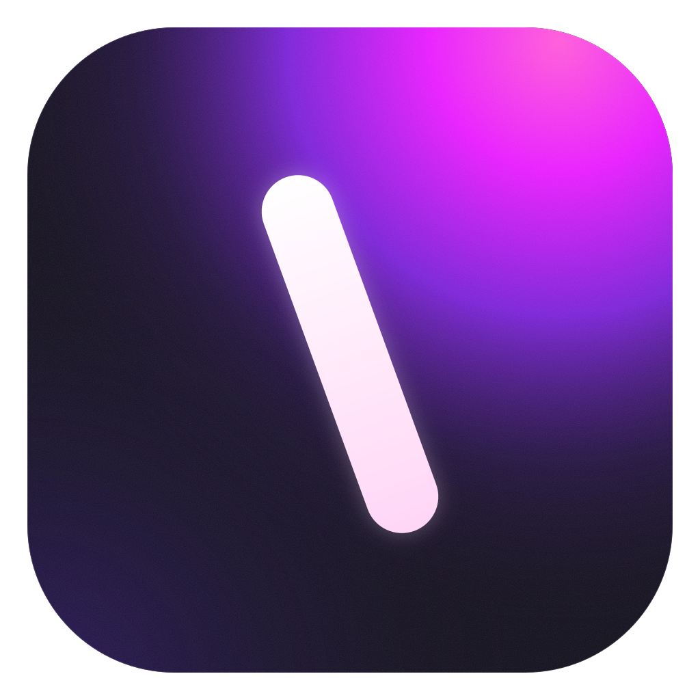
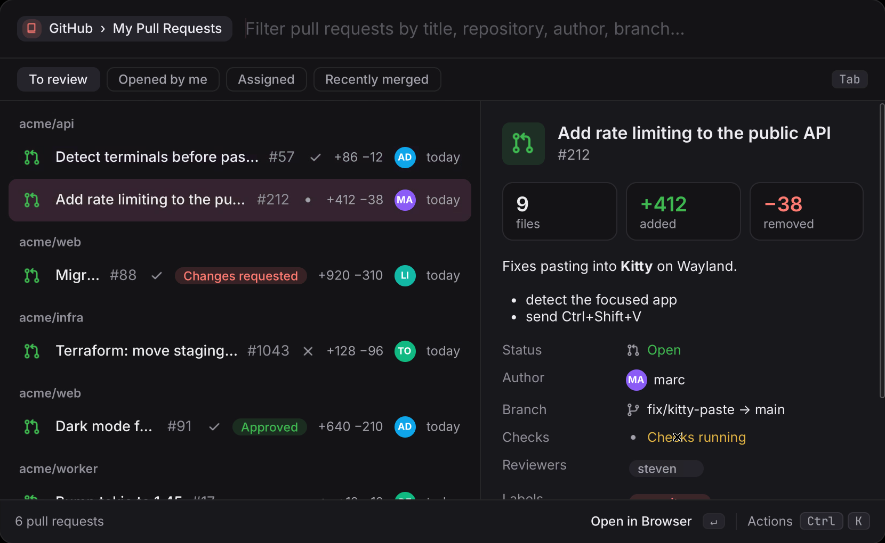
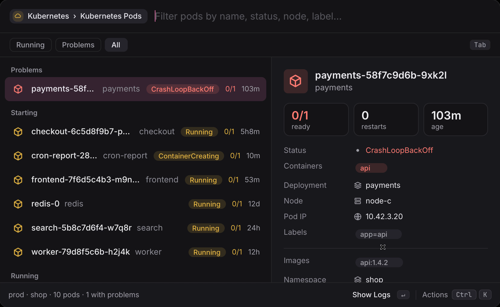
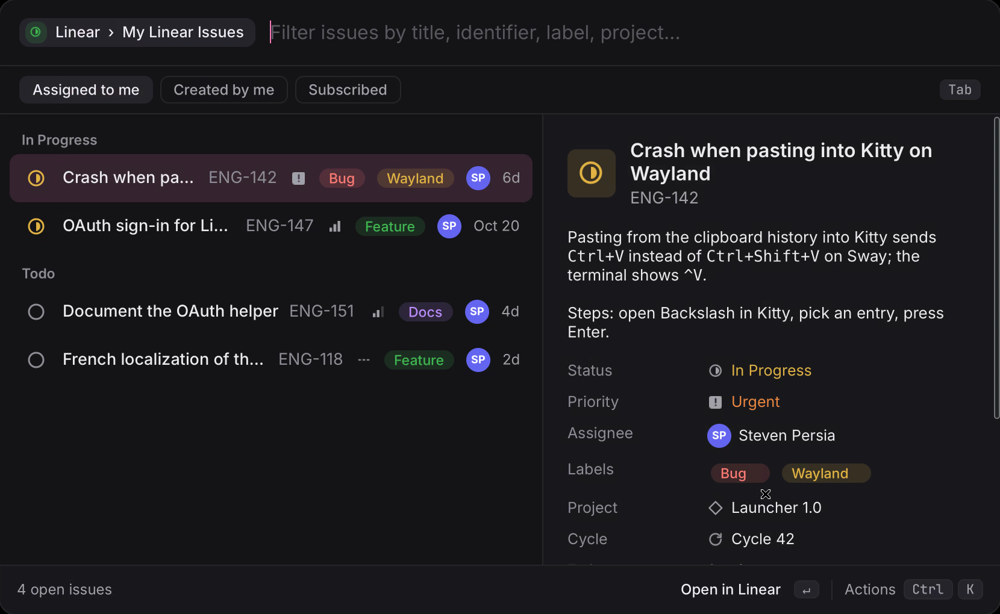
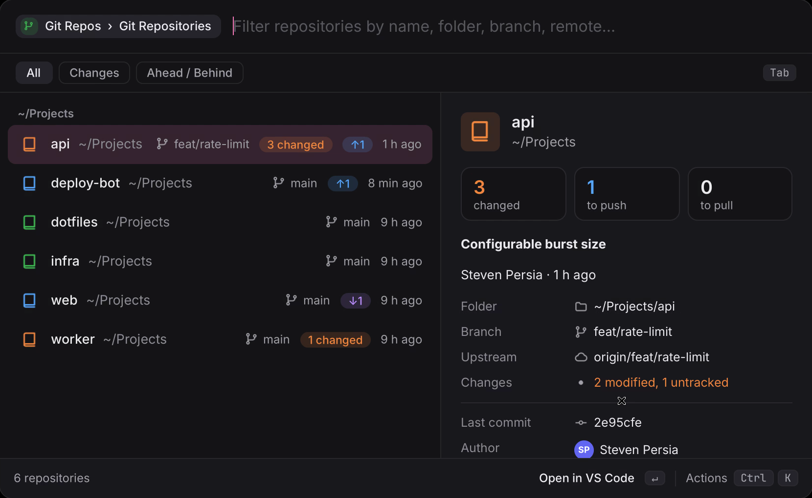
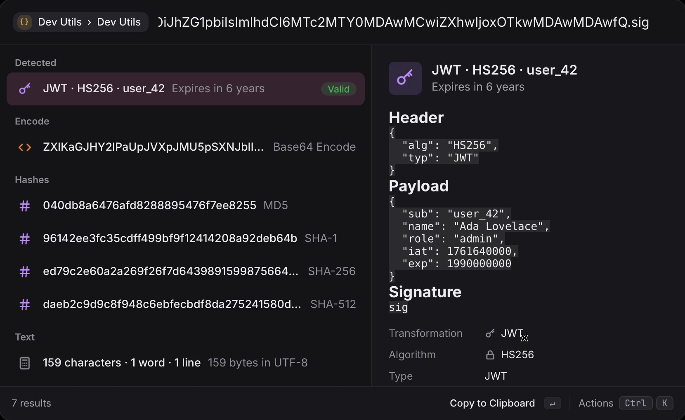

<h1 align="center">Backslash</h1>

<b>The launcher your Linux desktop deserves.</b> 
Apps, files, clipboard, math, and your whole dev stack, one keystroke away.

  
  
  
  

  
   <a href="docs/media/demo.mp4">▶ Watch it in HD</a>

  <a href="#install"><b>Install</b></a> ·
  <a href="https://github.com/backslash-app/plugins"><b>Extensions</b></a> ·
  <a href="docs/USAGE.md">Guide</a> ·
  <a href="docs/EXTENSIONS.md">Write an extension</a>

---

## What is it?

Press <kbd>Super</kbd>+<kbd>Space</kbd>, type a few letters, hit <kbd>Enter</kbd>.
Backslash is a native, keyboard-first launcher for Linux (in the spirit of
Raycast and Alfred) that opens instantly and goes much further than starting
apps: review pull requests, triage issues, find the crashing pod or decode a
JWT without leaving the keyboard.

<table>
  <tr>
    <td width="50%">
<b>GitHub</b>: pull requests with checks and reviews
</td>
    <td width="50%">
<b>Kubernetes</b>: problems first, logs one key away
</td>
  </tr>
  <tr>
    <td width="50%">
<b>Linear</b>: triage, assign, change status
</td>
    <td width="50%">
<b>Git Repos</b>: every repo, branch and pending change
</td>
  </tr>
</table>

## Why you'll like it

|  |  |
|---|---|
| ⚡ **Instant** | One small Rust + GTK4 binary that stays in the background. Wayland and X11. |
| 🐧 **Made for Linux** | Your apps (Flatpak and Snap too), your icon theme, your light or dark mode. GNOME, KDE, Hyprland, Sway, niri… |
| 🧩 **Extensions for everything** | A large and growing library, installed from the built-in store. Each one says what it may access, you approve it once, and the sandbox enforces it. |
| 🛠️ **Built for developers** | Extensions in TypeScript, no build step. Scripts in any language become commands. Everything runs from the terminal too: `backslash run github/pull-requests --json`. |
| 📋 **Useful from day one** | Calculator and conversions as you type, clipboard history, file search, window switcher, snippets and quicklinks. |
| 🔓 **Yours** | Open source (MIT). No account, no telemetry, no paywall. Plain config files for your dotfiles. |

## Extensions for developers

A few of the [many extensions](https://github.com/backslash-app/plugins#first-party-extensions), with more added all the time:

| | |
|---|---|
| **Code and reviews** | [GitHub](https://github.com/backslash-app/plugins/tree/main/extensions/github) · [GitLab](https://github.com/backslash-app/plugins/tree/main/extensions/gitlab) · [Codeberg](https://github.com/backslash-app/plugins/tree/main/extensions/codeberg) · [Git Repos](https://github.com/backslash-app/plugins/tree/main/extensions/git-repos) · [Code Projects](https://github.com/backslash-app/plugins/tree/main/extensions/projects) |
| **Issues and errors** | [Linear](https://github.com/backslash-app/plugins/tree/main/extensions/linear) · [Jira](https://github.com/backslash-app/plugins/tree/main/extensions/jira) · [Sentry](https://github.com/backslash-app/plugins/tree/main/extensions/sentry) · [Trello](https://github.com/backslash-app/plugins/tree/main/extensions/trello) · [ClickUp](https://github.com/backslash-app/plugins/tree/main/extensions/clickup) |
| **Cloud and deploys** | [Kubernetes](https://github.com/backslash-app/plugins/tree/main/extensions/kubernetes) · [AWS](https://github.com/backslash-app/plugins/tree/main/extensions/aws) · [Google Cloud](https://github.com/backslash-app/plugins/tree/main/extensions/google-cloud) · [Cloudflare](https://github.com/backslash-app/plugins/tree/main/extensions/cloudflare) · [Vercel & Netlify](https://github.com/backslash-app/plugins/tree/main/extensions/deployments) |
| **Local stack** | [Containers](https://github.com/backslash-app/plugins/tree/main/extensions/docker) · [Ports](https://github.com/backslash-app/plugins/tree/main/extensions/ports) · [Databases](https://github.com/backslash-app/plugins/tree/main/extensions/databases) · [Services](https://github.com/backslash-app/plugins/tree/main/extensions/systemd) · [System Logs](https://github.com/backslash-app/plugins/tree/main/extensions/system-logs) · [SSH Hosts](https://github.com/backslash-app/plugins/tree/main/extensions/ssh) · [Terminal Sessions](https://github.com/backslash-app/plugins/tree/main/extensions/terminal-sessions) · [Distrobox & VMs](https://github.com/backslash-app/plugins/tree/main/extensions/distrobox) |
| **Everyday tools** | [Dev Utils](https://github.com/backslash-app/plugins/tree/main/extensions/dev-utils) · [HTTP Client](https://github.com/backslash-app/plugins/tree/main/extensions/http-client) · [Regex Tester](https://github.com/backslash-app/plugins/tree/main/extensions/regex) · [Cron Helper](https://github.com/backslash-app/plugins/tree/main/extensions/cron) · [Dev Reference](https://github.com/backslash-app/plugins/tree/main/extensions/dev-reference) · [Docs & tldr](https://github.com/backslash-app/plugins/tree/main/extensions/docs) · [Package Registries](https://github.com/backslash-app/plugins/tree/main/extensions/package-registries) · [Nerd Font Icons](https://github.com/backslash-app/plugins/tree/main/extensions/nerd-fonts) |
| **AI** | [AI](https://github.com/backslash-app/plugins/tree/main/extensions/ai) (Claude, OpenAI, Mistral, Ollama…) · [Ollama Models](https://github.com/backslash-app/plugins/tree/main/extensions/ollama) |

 Paste a JWT, a timestamp or some Base64: Dev Utils already knows what it is.

Missing one? An extension is a TOML file and a TypeScript file, and
`backslash new` writes them for you. See the [extension guide](docs/EXTENSIONS.md).

## Install

Backslash needs GTK 4.14 or newer (Ubuntu 24.04+, Debian 13+, Fedora 40+, Arch,
openSUSE Tumbleweed…). Get the package for your system from the
[latest release](https://github.com/backslash-app/backslash/releases/latest):

| Distribution | Command |
|---|---|
| Debian, Ubuntu | `sudo apt install ./backslash_<version>_amd64.deb` |
| Fedora, openSUSE | `sudo dnf install ./backslash-<version>-1.x86_64.rpm` |
| Arch | `makepkg -si` with [`packaging/aur/PKGBUILD`](packaging/aur/PKGBUILD) |
| Anything else | `tar -xzf backslash-<version>-x86_64.tar.gz -C ~/.local` |

Then open it with <kbd>Super</kbd>+<kbd>Space</kbd>: a short welcome checklist
sets up the shortcut, theme and launch at login. The [guide](docs/USAGE.md)
covers shortcuts on every desktop, keys, script commands, configuration and
building from source.

## Contributing

Ideas, bug reports and pull requests are welcome: see
[CONTRIBUTING.md](CONTRIBUTING.md), the [architecture](docs/ARCHITECTURE.md) and
the [roadmap](docs/ROADMAP.md). Extensions go to
[backslash-app/plugins](https://github.com/backslash-app/plugins).

## License

[MIT](LICENSE)
